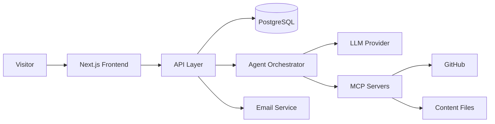

# architecture.md — System Architecture

## 1. Overview


## 2. Layers
| Layer | Responsibility |
|---|---|
| Presentation | Pages, components, SEO, theming |
| API | Validation, auth, rate limiting, business logic |
| Data | ORM, migrations, queries |
| AI | Agent orchestration, tool calls, prompts |
| Integrations | Email, analytics, GitHub, storage |

## 3. Folder Structure
```
/
├── app/                # routes & pages
├── components/         # UI components
├── lib/                # utilities, db client, auth
├── agents/             # agent definitions & prompts
├── mcp/                # MCP client + server configs
├── prisma/             # schema & migrations
├── tests/              # unit, integration, e2e
├── docs/               # these .md files
└── public/
```

## 4. Key Decisions (ADR summary)
| # | Decision | Reason |
|---|---|---|
| 1 | Next.js (SSR/SSG) | SEO + performance |
| 2 | PostgreSQL + Prisma | Typed queries, easy migrations |
| 3 | MCP for tools | Standard way to expose tools to agents |
| 4 | Serverless hosting | Low cost, zero ops |

## 5. Data Flow: AI Chat
1. User sends message → `POST /api/chat`.
2. API validates, rate-limits, loads conversation.
3. Orchestrator builds prompt + available tools.
4. LLM may call MCP tools (e.g. `get_projects`).
5. Response streamed back to the UI.
6. Conversation stored (if enabled).

## 6. Scalability & Performance
- Static generation + ISR for content pages.
- CDN for assets, image optimisation.
- Connection pooling for DB.
- Response caching for frequent agent queries.

## 7. Observability
Structured logs, error tracking (e.g. Sentry), uptime checks, basic analytics.
