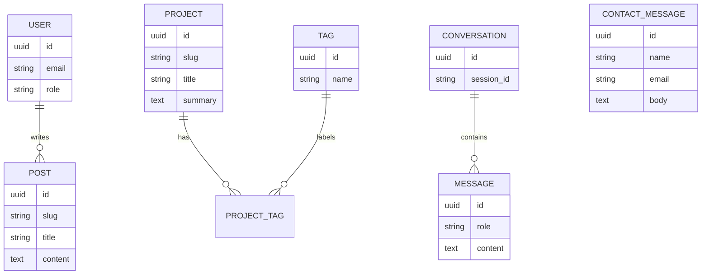

# database.md — Database Design

**Engine:** PostgreSQL · **ORM:** Prisma

## 1. ER Diagram


## 2. Tables
### users
| Column | Type | Notes |
|---|---|---|
| id | uuid PK | |
| email | text unique | |
| password_hash | text | argon2/bcrypt |
| role | enum(admin) | |
| created_at | timestamptz | default now() |

### projects
| Column | Type | Notes |
|---|---|---|
| id | uuid PK | |
| slug | text unique | URL |
| title | text | |
| summary | text | |
| content | text | Markdown |
| repo_url / live_url | text | |
| featured | boolean | |
| published | boolean | |
| created_at / updated_at | timestamptz | |

### tags, project_tags
`tags(id, name unique)` · `project_tags(project_id, tag_id)` composite PK.

### posts
`id, slug, title, excerpt, content, published, published_at`

### contact_messages
`id, name, email, body, ip_hash, created_at, handled boolean`

### conversations / messages
`conversations(id, session_id, created_at)` · `messages(id, conversation_id, role, content, created_at)`

## 3. Indexes
- `projects(slug)`, `projects(featured, published)`
- `posts(slug)`, `posts(published_at DESC)`
- `messages(conversation_id, created_at)`

## 4. Prisma Snippet
```prisma
model Project {
  id        String   @id @default(uuid())
  slug      String   @unique
  title     String
  summary   String
  content   String
  featured  Boolean  @default(false)
  published Boolean  @default(false)
  tags      ProjectTag[]
  createdAt DateTime @default(now())
  updatedAt DateTime @updatedAt
}
```

## 5. Migrations
```bash
npx prisma migrate dev --name <change>   # local
npx prisma migrate deploy                # production
npx prisma db seed                       # sample data
```

## 6. Backups & Data Policy
- Automated daily backups (provider feature).
- Store only hashed IPs; delete contact messages after 12 months.
