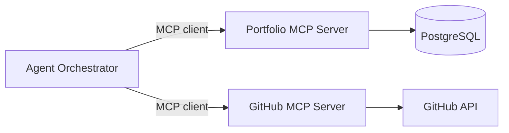

# mcp-connection.md — MCP (Model Context Protocol) Connection

## 1. What & Why
MCP is a standard way for AI agents to discover and call tools/data sources. The portfolio exposes its content through an MCP server so agents (and compatible clients) can query it safely.

## 2. Topology


## 3. Servers
| Server | Purpose | Transport | Access |
|---|---|---|---|
| `portfolio` | Projects, posts, résumé | stdio (local) / HTTP (remote) | Read-only |
| `github` | Repo metadata, README, languages | HTTP/stdio | Read-only token |
| `filesystem` (optional) | Local content drafts | stdio | Admin only |

## 4. Portfolio MCP Server — Tools
| Tool | Input | Output |
|---|---|---|
| `get_projects` | `{ tag?, featured? }` | list of projects |
| `get_project` | `{ slug }` | project detail |
| `search_posts` | `{ query }` | matching posts |
| `get_resume` | `{}` | skills + experience |

Resources (optional): `portfolio://projects/{slug}`, `portfolio://resume`.

## 5. Config Example
`mcp/config.json`
```json
{
  "mcpServers": {
    "portfolio": {
      "command": "node",
      "args": ["./mcp/portfolio-server.js"],
      "env": { "DATABASE_URL": "${DATABASE_URL}" }
    },
    "github": {
      "command": "npx",
      "args": ["-y", "@modelcontextprotocol/server-github"],
      "env": { "GITHUB_PERSONAL_ACCESS_TOKEN": "${GITHUB_TOKEN}" }
    }
  }
}
```

## 6. Minimal Server Skeleton (TypeScript)
```ts
import { McpServer } from "@modelcontextprotocol/sdk/server/mcp.js";
import { StdioServerTransport } from "@modelcontextprotocol/sdk/server/stdio.js";
import { z } from "zod";

const server = new McpServer({ name: "portfolio", version: "1.0.0" });

server.tool("get_projects", { tag: z.string().optional() }, async ({ tag }) => {
  const projects = await listProjects({ tag }); // your DB call
  return { content: [{ type: "text", text: JSON.stringify(projects) }] };
});

await server.connect(new StdioServerTransport());
```

## 7. Connecting & Testing
1. Start the server: `node mcp/portfolio-server.js`.
2. Inspect with the MCP Inspector: `npx @modelcontextprotocol/inspector node mcp/portfolio-server.js`.
3. Call each tool with sample input and verify output schema.
4. Wire the client into the agent orchestrator (`agents.md`).

## 8. Security
- Read-only DB user for the MCP server.
- Public agents only get the `portfolio` read tools.
- Validate all tool inputs; cap result sizes.
- Tokens scoped to minimum permissions; never log them.
- Treat tool output as untrusted data in prompts.

## 9. Troubleshooting
| Symptom | Check |
|---|---|
| Tools not listed | Server crashed on start; run it manually |
| Timeout | Slow DB query; add index/limit |
| Auth error (GitHub) | Token scope/expiry |
| Garbled output | Log to stderr, not stdout (stdio transport) |
